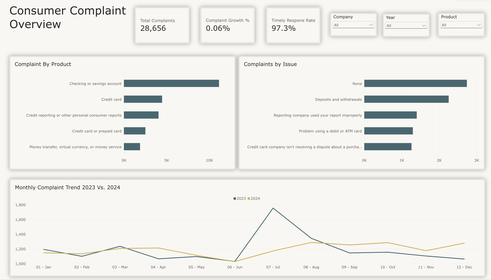

 

 

 
---

# CFPB_Bank_Complaint

---

## Project Overview

This project analyzes 28,656 Bank of America consumer complaints submitted to the Consumer Financial Protection Bureau (CFPB) between 2023 and 2024.

The objective is to identify consumer complaint trends, determine which financial products and issues generate the most complaints, and evaluate company response performance.

PostgreSQL was used for data cleaning, validation, and analysis, while Power BI was used to develop an interactive dashboard that communicates key findings and supports data-driven decision-making.

---

## Business Questions
1. How has consumer complaint volume changed over the past 2 years?
2. Which financial products and issues are driving the most complaints?
3. Are companies responding to consumer complaints on time?

---

## Dataset

Source: CFPB Consumer Complaint Database

Reporting Period: January 2023 – December 2024.

Total Records: 28,656.

Company: Bank of America.

The dataset contains information about consumer complaints involving financial products and services.

Key columns used in this analysis include:

- complaint_id
- date_received
- product
- issue
- company
- state
- timely_response

---

## Data Cleaning and Preparation

The original dataset was imported into PostgreSQL and assessed for data quality before analysis.

The cleaning and preparation process included:

**Duplicate Detection**: Checked for duplicate complaint IDs to verify record uniqueness.

**Missing Value Analysis**: Identified NULL values, blank strings, and missing-value placeholders.

**Date Validation:** Reviewed complaint dates and restricted the reporting period to 2023–2024.

**Category Validation**: Examined product and issue categories for consistency across reporting years.

**Geographic Classification**: Grouped geographic values into U.S. states, Washington D.C., U.S. territories, military addresses, and missing values.

The original data was preserved while cleaned views were used for SQL analysis and Power BI reporting.

---

## SQL Analysis

PostgreSQL was used to calculate complaint trends, identify recurring consumer issues, and evaluate company response performance.

SQL techniques used:

* Aggregations: COUNT(), SUM(), GROUP BY
* Window Functions: LAG(), OVER()
* Common Table Expressions: WITH
* Conditional Aggregation: FILTER (WHERE ...)
* Data Cleaning: CASE, TRIM(), NULLIF(), COALESCE()
* Date Analysis: DATE_TRUNC(), EXTRACT()

---

## Key Findings

1. Consumer Complaint Trends

Consumer complaint volume remained relatively stable between 2023 and 2024, increasing by only 0.06%

| Year       | Total Complaints |
|------------|------------------|
| 2023       | 14,315           |
| 2024       | 14,323.          |
| YOY Growth | +0.06%           |

Despite stable annual totals, monthly complaint activity fluctuated significantly.

In July 2023, complaint volume increased from 1,032 to 1,757, representing a 70.25% month-over-month increase. Complaints then decreased by 23.39% in August.

Monthly complaint volumes fluctuated less dramatically in 2024.

2. Financial Products and Consumer Issues

Checking or savings accounts generated the highest complaint volume, with 6,206 complaints involving account management.

Other common product-issue combinations included:

| Financial Product           | Consumer Issue                  | Complaints |
|-----------------------------|---------------------------------|------------|
| Checking or savings account | Managing an account             | 6,206      |
| Credit reporting            | Improper use of consumer report | 1,718      |
| Credit reporting            | Incorrect information on report | 1,487      |
| Checking or savings account | Opening an account              | 1,483      |
| Checking or savings account | Closing an account              | 1,466      |  
| Credit reporting            | Purchase shown on statement     | 1,353      |

These findings highlight account management, credit reporting, and credit card disputes as important areas for further investigation.

Data consideration: Some CFPB product categories changed between reporting years. These classification differences must be accounted for before interpreting product-level year-over-year growth.

3. Company Response Performance

Bank of America responded to 97.29% of complaints on time during the reporting period.

| Performance Metric   | Value  | 
|----------------------|--------|
| Total Complaints     | 28,656 |
| Timely Response      | 27,879 |
| Late Response        | 777    |
| Timely Response Rate | 97.29% |

Checking or savings accounts accounted for the highest number of late responses, with 364 complaints (3.27% late response rate).

The older credit reporting category recorded a 6.57% late response rate, while the combined credit card/prepaid card category recorded 4.93%.

These findings indicate that overall response timeliness was high, although certain product categories experienced more delays.

---

## Business Recommendations

1. Prioritize Account Management Improvements

Account management generated the largest number of complaints. Review frequently reported issues involving account access, transactions, and account servicing to identify potential process improvements.

2. Strengthen Complaint Monitoring

Implement monthly complaint tracking to detect unusual increases and emerging problems. Investigate significant changes such as the July 2023 spike to determine which financial products and issues contributed most.

3. Improve Response Timeliness

Monitor late response rates across financial product categories and investigate possible delays in complaint-handling processes. Establish escalation procedures for complaints approaching response deadlines.

---

## Power BI Dashboard

An interactive dashboard was developed using Power BI in Microsoft Fabric to visualize complaint patterns and response performance.

Dashboard Features:
* Total Complaints KPI
* Year-over-Year Complaint Growth
* Timely Response Rate KPI
* Monthly Complaint Trends (2023 vs. 2024)
* Complaints by Financial Product
* Top Consumer Issues
* Product Response Performance
* Interactive Filters

### Dashboard Preview

*Executive Summary Dashboard - Key Performance Indicators*

---

## Project Limitations

* The dataset focuses exclusively on Bank of America complaints submitted to the CFPB during the selected reporting period.
* Complaint counts do not account for differences in customer population or product usage.
* Product category changes between 2023 and 2024 may affect direct year-over-year comparisons.
* Complaint data alone cannot establish the underlying causes of consumer issues or response delays.

---

## Conclusion
* Analysis of 28,656 Bank of America consumer complaints revealed that overall complaint volume remained relatively stable between 2023 and 2024, despite notable monthly fluctuations.
* Account management was the largest complaint driver, while credit reporting and card-related issues represented other significant areas of concern.
* Bank of America maintained a 97.29% timely response rate, although 777 complaints were recorded as late responses.
* The findings highlight opportunities for improved complaint monitoring, targeted investigation of recurring issues, and more consistent response performance.

---

## Skills Demonstrated

SQL & PostgreSQL: Data Cleaning, Data Validation, CTEs, Window Functions, Aggregations, Conditional Aggregation, SQL Views

Power BI: DAX Measures, KPI Reporting, Data Visualization, Interactive Dashboards, Date Tables

Data Analysis: Trend Analysis, Year-over-Year Growth, Month-over-Month Growth, Complaint Categorization, Performance Analysis

Business Analytics: Business Questions, Analytical Reporting, Data Storytelling, Business Recommendations

